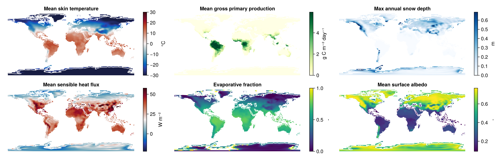

# Summary

The land surface is a crucial component of Earth's climate system.
Terrestrial ecosystems, as well as the solid earth that hosts them, exchange heat, water, and carbon with the atmosphere on timescales ranging from seconds to millenia, driving key feedbacks that significantly affect both local and global climate conditions.
Land surface and terrestrial ecosystem models aim to simulate the physical processes governing the land and ecosystem response to changes in both weather and climate as well as interactions between the land surface and the atmosphere.
They are therefore critically important components of *Earth System Models* (ESMs) which aim to simulate the natural variability of the Earth system, as well as its long-term response to changes in both natural and anthropogenic forcing.

Terrarium.jl is a software package in the Julia programming language [@bezansonJuliaFreshApproach2017] that aims to enable fast, flexible, and user-friendly land surface and terrestrial ecosystem modeling both standalone and coupled to other Earth system component models.
It enables the user to quickly and flexibly configure and run simulations of terrestrial heat, water, and carbon dynamics at both global and regional scales.
The numerical implementation is based on Oceananigans.jl [@ramadhanOceananigansjlFastFriendly2020; @wagnerHighlevelHighresolutionOcean2025], a widely used software package for "ocean-flavored" fluid dynamics that provides a rich set of numerical primitives for finite volume computations on orthogonal grids that can be massively parallelized on Graphics Processing Units (GPUs) and are compatible with automatic differentiation (AD).
Terrarium.jl uses these primitives to solve the relevant governing equations for nonlinear transport in porous media (i.e. soil and rock), as well as to facilitate the efficient computation of point-scale processes like the vegetation carbon cycle, surface hydrology, and the exchange of water and energy between the land surface and the atmosphere.

Terrarium.jl is being developed as part of the NumericalEarth project, which is an international community of researchers and software developers dedicated to building modern and accessible tools for multi-scale, multi-architecture, and fully differentiable Earth system modeling, centered around Oceananigans as a numerical core.

# Statement of need

Most existing ESM land components, including those involved in the international Coupled Model Intercomparison Project (CMIP), are implemented in statically compiled languages such as Fortran (and less commonly, C/C++); these languages, despite their advantages, incur a significant engineering burden and limit the accessibility of the model code for many scientists and researchers.
The reliance on Fortran/C++ also inhibits the adoption of state-of-the-art tools for high-level GPU programming and AD which have served as the technological foundation on which of recent developments in machine learning and data-driven modeling are built [@gelbrechtDifferentiableProgrammingEarth2023]. As such, we believe that there is a general need for a new generation of ESM components that are built using modern numerical computing software written in higher level, dynamic languages such as Julia or Python that offer robust and easy-to-use tooling for GPU acceleration and AD. Such modernized ESMs have the potential to greatly improve productivity as well as accessibility for researchers who lack extensive programming experience.

Another limitation of many existing land models is that they tend to mix physics and numerics in an *ad hoc* and inconsistent manner [@clarkNumericalImplementationLand2021].
This makes it difficult for land models to take advantage of state-of-the-art numerical tools since incorporating them would also require reformulating the simulated physics.
Terrarium.jl strives to overcome this limitation by formulating all physical processes in terms of continuous-time dynamics and enforcing a clear separation between the instantaneous tendencies of the system and the numerical scheme used to discretize the corresponding governing equations in time.
In addition, state variables are classified as *prognostic* (evolved in time), *auxiliary* (instantaneously derived from the prognostic state), or *inputs* (externally prescribed).
Constitutive relationships between prognostic and auxiliary variables are explicitly declared and evaluated separately from the tendency and timestepping scheme.
This design facilitates the implementation and comparison of new solvers and time discretization schemes while also helping to maintain mathematical consistency between model components.

# State of the field

There have been numerous recent efforts to reformulate land models in modern programming languages, such as DifferLand [@fangDifferentiableLandModel2026] and JAX-CanVeg [@jiangJAXCanVegDifferentiableLand2025], both of which enable GPU-accelerated and AD-compatible land modeling using Python/JAX.
Similarly, recent work by the Climate Modeling Alliance (CliMA) on ClimaLand.jl [@deckClimaLandLandSurface2026] has demonstrated the promise of GPU-accelerated land modeling in Julia as part of the CliMA project, which aims to build a new, CMIP-class ESM capable of being automatically calibrated using global observational datasets [@schneiderEarthSystemModeling2017; @dunbarCalibrationUncertaintyQuantification2021].
In contrast, Terrarium.jl enables not only GPU-accelerated land simulations but also full comaptibility with both forward- and reverse-mode AD via Enzyme.jl and Reactant.jl [@mosesInsteadRewritingForeign2020; @mosesDJ4EarthDifferentiablePerformancePortable2026].
Moreover, Terrarium.jl is designed to allow for fast and efficient coupling with other global or regional, GPU-accelerated ESM components such as the SpeedyWeather.jl [@klowerSpeedyWeatherjlReinventingAtmospheric2024] and Breeze.jl [@wagnerBreezejl2026] atmospheric models. 
As such, Terrarium.jl represents a significant step towards modernizing process-based land modeling.

# Software design

![Overview of the Terrarium.jl software design. Models (blue) are built from one or more `Process`es (purple) which may contain additional parameterization types that determine which equations and parameters are used. Each `Process` type defines GPU-aware kernels that implement the physics using Oceananigans operators where needed. Models and any necessary user inputs (green) -- such as spatially-varying boundary conditions -- are passed to `initialize` which allocates the model state and configures the time stepper. The resulting `integrator` is stepped forward in time using `timestep!` which propagates from the model down to the underlyling `Process`es. Each `Process` defines device-agnostic compute kernels that are "launched" over the underlying spatial grid. \label{fig:design}](assets/figure1.png)

Terrarium.jl is designed to be highly modular, acting as a framework for constructing a multitude of different land model configurations rather than implementing a single, monolithic model.
This allows Terrarium to serve as a common set of numerical tools and physical process implementations which can serve as the basis for a wide range of land and ecosystem models, spanning both highly detailed local-scale simulations with prescribed boundary conditions and intermediate-complexity global-scale simulations as part of a coupled Earth system model.
Terrarium models are composed of four basic components: one or more `Process`es (subtyping `AbstractProcess`) implementing specific physical relationships and governing equations, a `grid` that describes the discretization of the underlying spatial domain, a `timestepper` that determines how the prognosic variables of the model are advanced in time, and an `initializer` that specifies how the initial state of the prognostic variables is determined \autoref{fig:design}.

Terrarium currently provides four primary model types that can be used to run simulations:

- `SoilModel`: A standalone model of energy, water, and carbon transport within a finite soil volume.
Currently, only vertical transport is considered; however, the `grid` abstraction is designed such that this assumption can be easily relaxed in the future.

- `VegetationModel`: A standalone model of the vegetation carbon cycle with atmosphere and soil state given as prescribed inputs.
This model can be used to test and evaluate vegetation processes in idealized simulations or when appropriate forcing inputs are available.

- `SnowModel`: A standalone model of snow accumulation and melt given prescribed atmosphere and soil inputs.

- `LandModel`: An integrated model that couples together soil, snow, vegetation, and surface hydrology processes given prescribed atmospheric inputs.
This is the primary model type used for realistic, global-scale land simulations.

Each of the above model types combine two or more `Process`es by defining all additional orchestration logic needed to wire together the various components.
Users can implement their models by defining subtypes of `AbstractModel` that satisfy its documented *method interface*.
In Julia, "methods" refer to variants of a function defined for a particular set of input argument types.
Julia's runtime then "dispatches" a function call to the matching method based on the types of the arguments supplied by the caller.

Similar to models, users can define new processes by extending `AbstractProcess`.
Each subtype of `AbstractProcess` is then required to implement the following:

- A method `variables(::Process)` that returns a tuple of state variables required by the `Process`.
Each variable must be declared as `prognostic`, `auxiliary`, or `input`,

- A method `compute_auxiliary!(state, grid, ::Process, args...)` which computes all `auxiliary` variables based on the current prognostic state,

- A method `compute_tendencies!(state, grid, ::Process, args...)` which computes the tendencies of the `prognostic` variables at the current time step.

Each `Process` type is free to specify additional arguments (here represented by `args...`) corresponding to other `Process` or helper types on which they are dependent.
Terrarium therefore relies heavily on Julia's system for multiple dispatch to choose the correct method implementation at runtime based on the types of the given arguments.

While the modular design of Terrarium.jl provides a powerful framework for mixing and matching various process implementations, it also comes with some important trade-offs.
Terrarium simultaneously prioritizes support for multi-architecture parallelization via KernelAbstractions.jl and automatic differentiation via Enzyme.jl and Reactant.jl.
Maximizing modularity would necessitate each `Process` launching its own GPU kernel, which can incur significant overhead in models that involve coupling together many interdependent physical processes.
To balance modularity with efficient parallelization, Terrarium `Process`es are typically implemented at three different levels of abstraction: a top-level interface (`compute_auxiliary!` and `compute_tendencies!`) which can be used to evaluate and test each `Process` type standalone, a grid-aware kernel function interface (e.g. `compute_energy_tendency(i, j, k, grid, fields, ::Process, args...)`) called at the given grid indices `i, j, k` within a device-agnostic compute kernel, and primitive functions (e.g. `physical_quantity(::Process, args...)`) that implement scalar equations independent of any particular spatial grid.
This pattern allows for most of the actual physics code (defined at the kernel level) to be reused across different kernels.
Terrarium makes use of this in "coupled" `Process` types which define fused kernels that bundle multiple `Process`es into a single component.
This allows developers to balance modularity with GPU efficiency, at the cost of some additional boilerplate incurred by the need to split functions across the different abstraction levels.

In terms of process implementations, Terrarium.jl currently provides an implementation of a soil energy-hydrology scheme that is loosely based on the equations and parameterizations of CryoGrid [@westermannCryoGridCommunityModel2023; @langerEvolutionArcticPermafrost2024; @groenkeCryoGridJL2024] with pedotransfer functions taken from SURFEX/ISBA [@massonSURFEXv72LandOcean2013; @noilhanISBALandSurface1996].
The surface energy balance, evapotranpsiration schemes, and vegetation/canopy processes are based primarily on PALADYN [@willeitPALADYNV10Comprehensive2016] which presently serves as the land component of the CLIMBER-X intermediate-complexity land surface model [@willeitEarthSystemModel2022].
Implementation of vegetation and soil carbon biogeochemistry is still underway but will be initially based on the approaches outlined by [@luoMatrixApproachLand2022] and [@ahrensCombinationEnergyLimitation2020] respectively.
It should be emphasized, however, that Terrarium.jl is expressly designed to accommodate multiple parallel formulations of physical processes and is thus not tied to any one set of governing equations.
It is, however, limited to the FVM spatial discretizations provided by Oceananigans.jl.

# Research impact statement

Terrarium.jl's modular design, GPU-compatibility, and first-class support for AD make it an ideal testbed for cutting edge research on so-called "hybrid" land-atmosphere modeling, which aims to combine data-driven components, such as neural networks, with physics-based simulation [@shenDifferentiableModellingUnify2023; gelbrechtDifferentiableProgrammingEarth2023].
Terrarium is being actively used to develop and evaluate the capabilities of such methods to improve the fidelity of global land and climate simulations.
This has the potential to help geoscientific researchers move beyond existing workflows where physics-based simulations are used only to generate training and validation data for machine learning models, towards a new generation of scientific models that are capable of learning from data while still respecting physical laws.

Terrarium.jl is also being developed as part of a larger effort to build a new generation of hybrid data- and physics-driven ESMs that are GPU- and AD-compatible.
To facilitate this effort, we maintain an extension module in NumericalEarth.jl [@wagnerNumericalEarthjl2026] that allows Terrarium simulations to be plugged in as a land component in `EarthSystemModel`, which provides a unified coupling interface for atmosphere, ocean, land, and sea ice models.
In addition, Terrarium supports direct coupling with the SpeedyWeather.jl atmosphere model [@klowerSpeedyWeatherjlReinventingAtmospheric2024], allowing for coupled land-atmosphere simulations using SpeedyWeather's native simulation interface.
These coupling interfaces will allow Terrarium.jl to directly contribute to ongoing research applying cutting-edge computational technologies to advance the frontiers of Earth system modeling.

# AI usage disclosure

No generative AI was used in the preparation of this manuscript.
Some parts of the software, including tests and documentation, are developed with AI assistance under strict human oversight.
All pull requests are reviewed and signed off by human developers.

# Acknowledgements

BG acknowledges the support of the Past2Future (P2F) project; The Past to Future (P2F) project has received funding from the European Union’s Horizon Europe research and innovation programme under grant agreement No. 101184070.
MG acknowledges funding from the Volkswagen Foundation and the European Union’s Horizon Europe research and innovation programme ClimTip (grant agreement no. 101137601), this is ClimTip contribution #XXX.
PLV acknowledges funding from the National Centre for Atmospheric Science and from Schmidt Futures (LEMONTREE project, #XXX)
Funded by the European Union.
Views and opinions expressed are however those of the author(s) only and do not necessarily reflect those of the European Union or the European Climate, Infrastructure and Environment Executive Agency (CINEA).
Neither the European Union nor the granting authority can be held responsible for them.

# References
